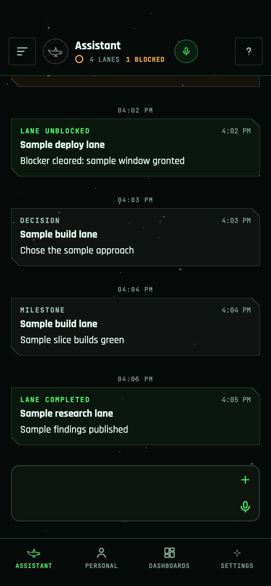
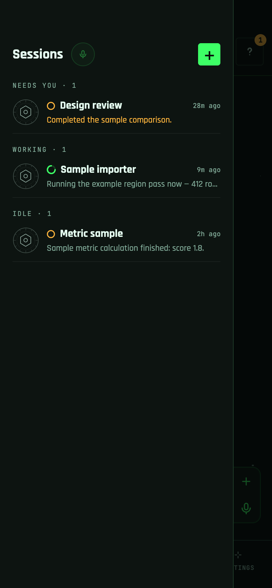
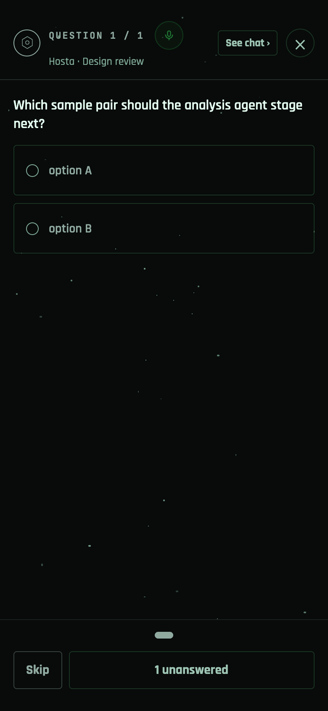
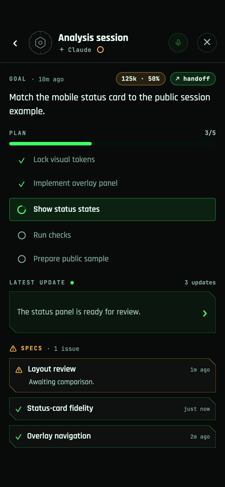

# Assistant and work lanes

How the always-on assistant and the work lanes list look and behave on the
phone. All screenshots use invented fixture data from the
[screenshot harness](SCREENSHOT_HARNESS.md); see [Capture notes](#capture-notes).
Source files and tests for the assistant tab are listed in the
[assistant shell guide](assistant_shell.md).

## Always-on assistant

The first tab is the assistant's conversation. The tab and header use the
assistant session's display name (default **Zephyr**). Most screenshots use a
session named **Assistant**; the expanded-specs image has no assistant session
and shows the default name. Setup is in the README's
[Always-on assistant](../README.md#always-on-assistant) section.

- **Header.** Left: the **Sessions** button. Its badge counts other chats that
  need an answer. Centre: the assistant's icon and name, a working/idle status
  ring, the open lane count (**N LANES**) and, when any lane is blocked,
  **N Blocked**. Tapping the icon, name or lane count opens the
  [work lanes list](#work-lanes). Right: the voice mic and the **?** Questions
  button. Its badge counts pending questions from every chat, including the
  assistant.
- **Conversation.** The same transcript, composer and voice input as any other
  session. When the daemon publishes a lane update, it appears in the thread as a
  card with its kind (**LANE STARTED**, **LANE Blocked**, **LANE UNBlocked**,
  **DECISION**, **MILESTONE**, **LANE COMPLETED**), the lane title and a one-line
  summary.
- **Sessions drawer.** Slides in from the left. Other chats are grouped as
  **Needs you**, **Working** and **IDLE**, each row with the chat's latest
  message preview. Tap a row to open that chat, or **+** to start a session on a
  machine. Close it with the scrim, system Back or a left swipe.

- **Questions.** **?** opens one deck with every open question across chats, one
  question per page. Answer some and submit, skip, or use **See chat** to jump to
  the asking chat. Details: [Questions overlay](QUESTIONS_OVERLAY.md).
- **Status card.** In a session that publishes a status card, tap the header
  title to open it:
  goal, context use, plan steps, the latest update and spec progress. On the
  assistant tab, the header opens the lanes list instead.

## Work lanes

Open `/pentacle/lanes` from the assistant header. The header counts lanes
working, in progress and quiet (idle plus paused). The map puts every working or
in-progress lane on the inner ring, up to eight; the hub is the size of an inner
lane ring and links run from edge to edge. Idle and paused lanes sit at the four
corners, then `+N`. The list below has Working now, In progress, Idle and Paused,
then a `Parked · N` button. A lane card shows a dot per goal in goal order, up to
two lead goals (working first, then in progress) and `+N more in progress`; an
idle or paused lane shows its next goal instead. A lane with an open question has
a yellow `?` button that expands the shipped question card inside the card.

A lane screen draws the lane's goals as a road, one stop per goal in goal order.
The two lead goals are expanded with their bar and up to three item rows; every
other stop is one line with a state word. Done members under no goal appear
under Finished earlier. A goal lists every item in Working now, Needs you, In
progress, Blocked, Next up, Later and Done. The item screen is the shipped spec
screen. Parked lanes are never on the map or in the sections.

Blocked is bright yellow and always carries a pattern: a hatched ring, a striped
bar, or a struck circle for an item mark and a home dot. Something moves only
where an agent is working now: the map link, a spark on the home goal ring, the
dashed rail and the item mark on a lane, the header spark and item mark on a
goal. Only the top screen animates. Screens open from the tapped point and back;
with Reduce Motion they replace each other and nothing loops.

The shared core (`readableLanes.ts`) owns goal order and numbers, next and
later, lane class, lead goals, dots, item kind and the stop state word. The
normalizer reads the daemon's `parked` and `goal_road` lane keys; a missing or
malformed value hides only the element that needs it.

The `lanes:roadmap_*` fixtures follow the daemon wire contract. The older
`lanes:readable_*` fixtures still cover sparse and older wire shapes. The
[screenshot harness](SCREENSHOT_HARNESS.md) captures the real components; native
release validation remains separate.

## Capture notes

Captured 2026-10-26 from `81f820e402d49e07e3e7b664794ae85eff31c7b5` under
react-native-web (the [screenshot harness](SCREENSHOT_HARNESS.md)) in headless
Chrome at 390×844, 2× scale, UTC. These are web renders of the real screens, not
native iOS captures, and may differ from iOS in small details. Fixtures:
`assistant:lane_updates` (assistant tab) and `session:status_card`. The lane
flow described above supersedes those historical lane captures; current flow
fixtures and the layout driver are documented in the screenshot harness. The Sessions
drawer and Questions images use the default populated fixture. The server ran
with `EXPO_PUBLIC_SCREENSHOT_HARNESS=1`, `EXPO_PUBLIC_HARNESS=1`,
`EXPO_PUBLIC_DISABLE_BIOMETRIC_LOCK=1`, a placeholder `EXPO_PUBLIC_HARNESS_TOKEN`
and `EXPO_PUBLIC_VOICE_RENDER_FIXTURE=1`, which gives voice an in-memory store
on web. Every image was
checked for personal names, real hosts and account details, and carries no
EXIF metadata.
