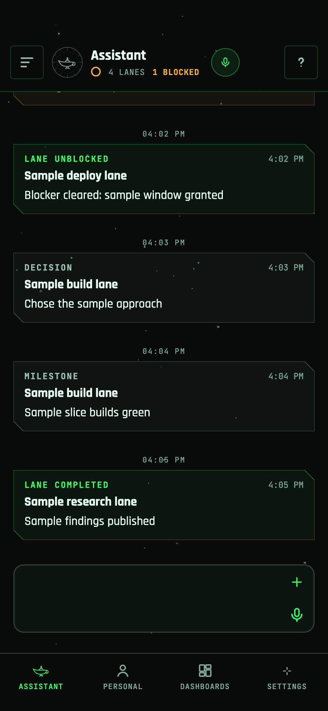
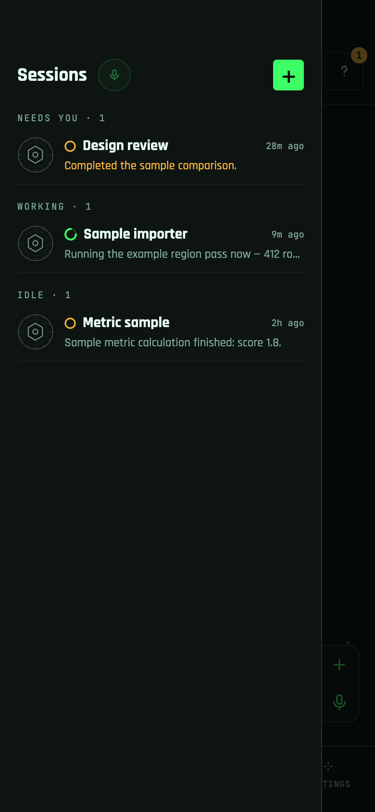
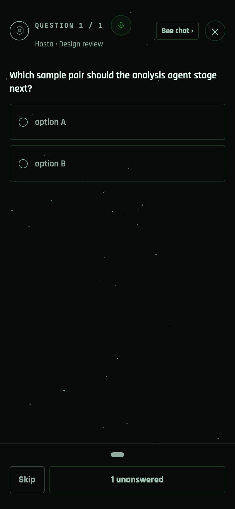
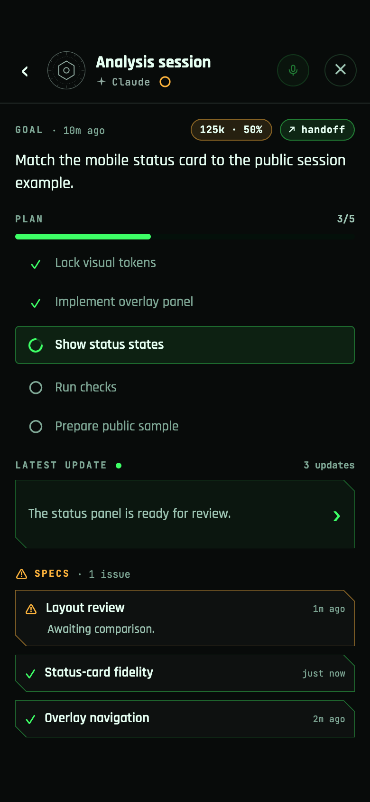

# Assistant and work lanes

How the always-on assistant and the work lanes list look and behave on the
phone. All screenshots use invented fixture data from the
[screenshot harness](SCREENSHOT_HARNESS.md); see [Capture notes](#capture-notes).
Source files and tests for the assistant tab are listed in the
[assistant shell guide](assistant_shell.md).

## Always-on assistant

The first tab is the assistant's conversation. The tab and header use the
assistant session's display name (default **Zephyr**). Most screenshots use a
session named **Assistant**; the expanded-specs image has no assistant session
and shows the default name. Setup is in the README's
[Always-on assistant](../README.md#always-on-assistant) section.

- **Header.** Left: the **Sessions** button. Its badge counts other chats that
  need an answer. Centre: the assistant's icon and name, a working/idle status
  ring, the open lane count (**N LANES**) and, when any lane is blocked,
  **N Blocked**. Tapping the icon, name or lane count opens the
  [work lanes list](#work-lanes). Right: the voice mic and the **?** Questions
  button. Its badge counts pending questions from every chat, including the
  assistant.
- **Conversation.** The same transcript, composer and voice input as any other
  session. When the daemon publishes a lane update, it appears in the thread as a
  card with its kind (**LANE STARTED**, **LANE Blocked**, **LANE UNBlocked**,
  **DECISION**, **MILESTONE**, **LANE COMPLETED**), the lane title and a one-line
  summary.
- **Sessions drawer.** Slides in from the left. Other chats are grouped as
  **Needs you**, **Working** and **IDLE**, each row with the chat's latest
  message preview. Tap a row to open that chat, or **+** to start a session on a
  machine. Close it with the scrim, system Back or a left swipe.

- **Questions.** **?** opens one deck with every open question across chats, one
  question per page. Answer some and submit, skip, or use **See chat** to jump to
  the asking chat. Details: [Questions overlay](QUESTIONS_OVERLAY.md).
- **Status card.** In a session that publishes a status card, tap the header
  title to open it:
  goal, context use, plan steps, the latest update and spec progress. On the
  assistant tab, the header opens the lanes list instead.

## Work lanes

The map draws every non-parked lane; parked lanes remain behind the Parked
button. It is exactly the screen width, capped at 440 points (the operator's
phone), never scrolls sideways and draws nothing outside its width.

- **Single ring.** With no idle or paused lanes and at most six working or
  in-progress lanes, the approved map: 52 point rings on a 108 point circle with
  names and ages under them.
- **Two circles.** Otherwise up to six busy (working or in-progress) lanes sit
  on the inner ring: 46 point rings on a 94 to 98 point circle with the name and
  age under each. With more than six, lanes with an open question come first,
  then working, then in progress, each by last activity. Every other lane goes
  on one outer circle with the hub as its centre: a 40 point ring with the name
  under it (at most two lines, no age). Busy outer lanes keep the green ring,
  progress arc and question mark, and a working one keeps a short stub of moving
  dashes towards the hub; quiet outer lanes are muted. Busy outer lanes take the
  places nearest 12 and 6 o'clock, then quiet lanes follow by last activity.
- **+N.** Lanes that do not fit fold into a dashed `+N` on the circle. Quiet
  lanes fold first, least recent first, into a muted `+N`; busy lanes fold only
  when they alone fill the circle, into a green `+N` with the muted one beside
  it. Every lane is named on the map or counted in exactly one `+N`. Tapping a
  `+N` scrolls the list so the top-most card it counts sits at the top.

Last activity is the stamp the card age shows: `state_at` for a paused lane,
otherwise `progress_at`. The Idle and Paused sections use the same order, so the
cards match the circle. The layout (`lanesRingLayout.ts`) ports `mapPlan` from
the approved mock with coarser search steps (radius by 4, start angle by half a
place) so it stays within about 8 ms on the phone's JS engine. Narrower phones
show fewer lanes on the circle under the same rules.

Home cards show at most two unfinished goals. Working, in-progress and blocked
goals all count as started. If none has started, show the first unfinished goal.
If exactly one has started, show it alone when it is first in lane order;
otherwise show the first unstarted goal followed by that started goal. With two
or more started goals, show the first two started goals in lane order. Paused
cards follow the same rule. Lane-detail expansion keeps its existing behavior.

Home cards fill missing goals from one lane-detail response when the bounded
inventory omits goals. This does not page through historical members. A failed
or stale response keeps an explicit unavailable state with lane navigation for
retry. This change leaves empty and completed lane presentation unchanged.
The collapsed Finished earlier list shares its section's single divider.

Open `/pentacle/lanes` from the assistant header. The header counts lanes
working, in progress and quiet (idle plus paused). The map is described above.
The hub is the size of an inner lane ring and links run from edge to edge. The list below has Working now, In progress, Idle
and Paused, then a `Parked · N` button. Cards show a dot per goal, the selected
goals described above and a count of additional in-progress goals when present.
A lane with an open question has a yellow `?` button that expands the shipped
question card inside the card.

A lane screen draws the lane's goals as a road, one stop per goal in goal order.
The two lead goals are expanded with their bar and up to three item rows; every
other stop is one line with a state word. Done members under no goal appear
under Finished earlier. A goal lists every item in Working now, Needs you, In
progress, Blocked, Next up, Later and Done. The item screen is the shipped spec
screen. Parked lanes are never on the map or in the sections.

Blocked is bright yellow and always carries a pattern: a hatched ring, a striped
bar, or a struck circle for an item mark and a home dot. Something moves only
where an agent is working now: the map link, a spark on the home goal ring, the
dashed rail and the item mark on a lane, the header spark and item mark on a
goal. Only the top screen animates. Screens open from the tapped point and back;
with Reduce Motion they replace each other and nothing loops.

The shared core (`readableLanes.ts`) owns goal order and numbers, next and
later, lane class, lead goals, dots, item kind and the stop state word. The
normalizer reads the daemon's `parked` and `goal_road` lane keys; a missing or
malformed value hides only the element that needs it.

The `lanes:roadmap_*` fixtures follow the daemon wire contract. The older
`lanes:readable_*` fixtures still cover sparse and older wire shapes. The
[screenshot harness](SCREENSHOT_HARNESS.md) captures the real components; native
release validation remains separate.

## External work and lane activity

Optional daemon fields add words in existing slots. Lane `activity: working`
places a lane under Working now even without a live seat; parked and paused
classification still takes precedence. `waiting_on_dot` adds `waiting on <label>`
before the card age and header sub line, using the lane's `external.label` or
Dot. `blocked` adds `blocked` there. Parked lanes add neither word. Other
activity values keep the existing presentation.

Member `external` entries are detail-only. A working entry makes an unfinished
item working after the open-question check. The detail table selects working,
then review, then queued, and places that entry's label and sentence above Now.
A queued-only item shows `Waiting for <label>` in its row, including the small
Later and Done rows, unless blocked or waiting for an operator answer. Other
rows keep the lead's Status text. Seat counts and the worked-hours meta line
remain unchanged.

Detail-only `latest_event` adds Latest immediately below Now only when its
stamp is newer than the item's progress, or progress is absent. It reads
`Review passed`, `Review failed`, or `Lead reported done`, followed by the
existing age. Same-observation inventory previews retain both detail keys;
a newer detail response replaces or clears them through `detail_revision`.
Malformed optional keys and unknown words never remove a lane or member;
malformed external entries are omitted independently. Missing keys keep the
previous screens.

The synthetic `lanes:readable_dot` fixture covers a waiting lane, a lane working
only through external work, all three packet states and all three report kinds.
`scripts/lanes-flow-v2-render.cjs` captures the added words at 390×844 and checks
that the long-title waiting card and its word-plus-age slot do not overlap or
escape the card. These fixture renders supplement the installed-client journey;
they do not establish native or live-daemon behavior.

## Capture notes

Captured 2026-10-26 from `81f820e402d49e07e3e7b664794ae85eff31c7b5` under
react-native-web (the [screenshot harness](SCREENSHOT_HARNESS.md)) in headless
Chrome at 390×844, 2× scale, UTC. These are web renders of the real screens, not
native iOS captures, and may differ from iOS in small details. Fixtures:
`assistant:lane_updates` (assistant tab) and `session:status_card`. The lane
flow described above supersedes those historical lane captures; current flow
fixtures and the layout driver are documented in the screenshot harness. The Sessions
drawer and Questions images use the default populated fixture. The server ran
with `EXPO_PUBLIC_SCREENSHOT_HARNESS=1`, `EXPO_PUBLIC_HARNESS=1`,
`EXPO_PUBLIC_DISABLE_BIOMETRIC_LOCK=1`, a placeholder `EXPO_PUBLIC_HARNESS_TOKEN`
and `EXPO_PUBLIC_VOICE_RENDER_FIXTURE=1`, which gives voice an in-memory store
on web. Every image was
checked for personal names, real hosts and account details, and carries no
EXIF metadata.
