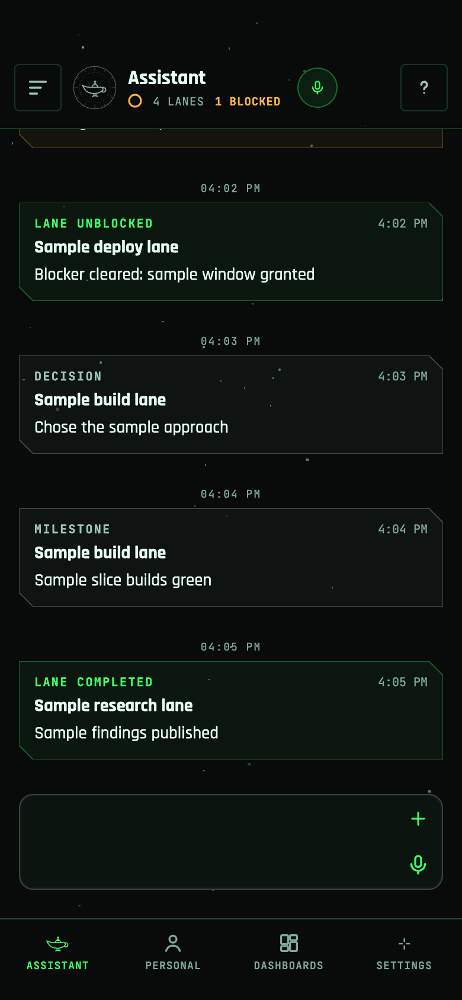
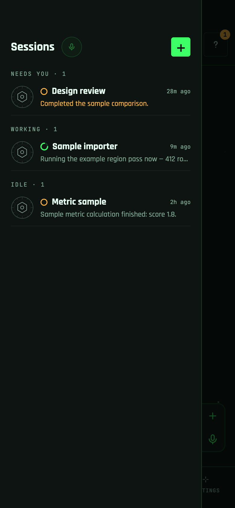
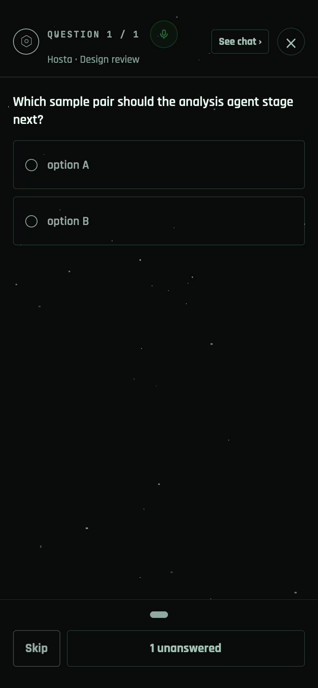
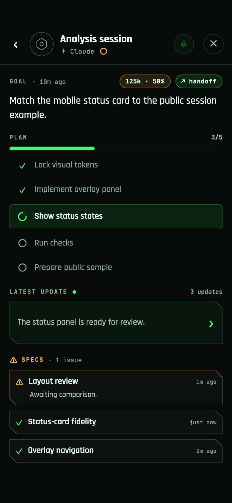
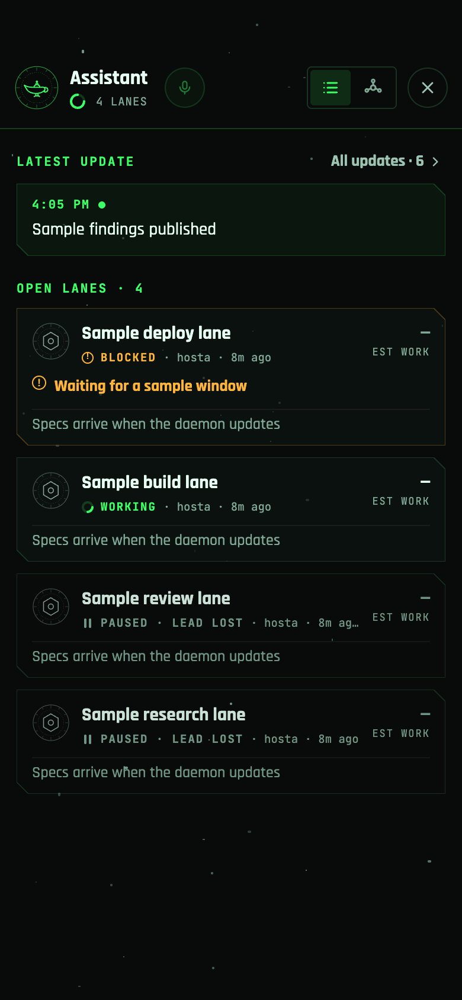
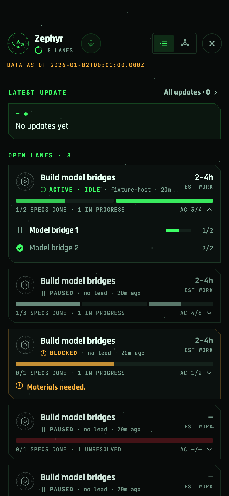
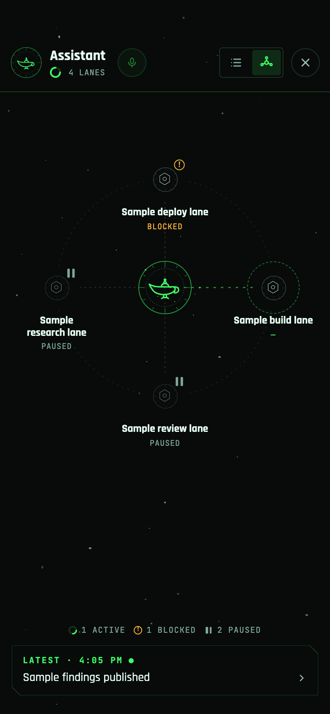

# Assistant and work lanes

How the always-on assistant and the work lanes list look and behave on the
phone. All screenshots use invented fixture data from the
[screenshot harness](SCREENSHOT_HARNESS.md); see [Capture notes](#capture-notes).
Source files and tests for the assistant tab are listed in the
[assistant shell guide](assistant_shell.md).

## Always-on assistant

The first tab is the assistant's conversation. The tab and header use the
assistant session's display name (default **Zephyr**). Most screenshots use a
session named **Assistant**; the expanded-specs image has no assistant session
and shows the default name. Setup is in the README's
[Always-on assistant](../README.md#always-on-assistant) section.

- **Header.** Left: the **Sessions** button. Its badge counts other chats that
  need an answer. Centre: the assistant's icon and name, a working/idle status
  ring, the open lane count (**N LANES**) and, when any lane is blocked,
  **N BLOCKED**. Tapping the icon, name or lane count opens the
  [work lanes list](#work-lanes). Right: the voice mic and the **?** Questions
  button. Its badge counts pending questions from every chat, including the
  assistant.
- **Conversation.** The same transcript, composer and voice input as any other
  session. When the daemon publishes a lane update, it appears in the thread as a
  card with its kind (**LANE STARTED**, **LANE BLOCKED**, **LANE UNBLOCKED**,
  **DECISION**, **MILESTONE**, **LANE COMPLETED**), the lane title and a one-line
  summary.
- **Sessions drawer.** Slides in from the left. Other chats are grouped as
  **NEEDS YOU**, **WORKING** and **IDLE**, each row with the chat's latest
  message preview. Tap a row to open that chat, or **+** to start a session on a
  machine. Close it with the scrim, system Back or a left swipe.

- **Questions.** **?** opens one deck with every open question across chats, one
  question per page. Answer some and submit, skip, or use **See chat** to jump to
  the asking chat. Details: [Questions overlay](QUESTIONS_OVERLAY.md).
- **Status card.** In a session that publishes a status card, tap the header
  title to open it:
  goal, context use, plan steps, the latest update and spec progress. On the
  assistant tab, the header opens the lanes list instead.

## Work lanes

A work lane is one stream of work the daemon tracks: a title, a state, the
lead session that drives it and the specs it contains. Lanes, their state and
their counts come from the daemon's work-lanes inventory. The app does not
infer lanes from chats. Open the list from the assistant header
(`/pentacle/lanes`).

- **Latest update.** The newest lane update, and **All updates · N** for the
  full update log, newest first. These are the same updates that appear as cards
  in the assistant's conversation.
- **Open lanes · N.** One card per open lane. Each card shows the state
  (**WORKING**, **ACTIVE · IDLE**, **ACTIVE · RECOVERING** while a lost lead is
  being replaced, **BLOCKED**, **PAUSED** or **PAUSED · LEAD LOST**), the lead's host (or *no lead*) and how long ago the
  lane last changed. On the right, **EST WORK** gives the open-work range in
  hours, or a short status such as *All specs done*. A blocked lane shows its
  blocker. When the daemon reports specs, a segmented bar and
  **done/total SPECS DONE** with acceptance counts (**AC**) appear. Tap that
  row to show or hide the lane's specs. Until the daemon sends them, the card
  reads *Specs arrive when the daemon updates*.
- **Open a lane.** Tap the lane's title row to go to its chat. An open chat
  opens normally; the assistant's own lane returns to the assistant tab. A closed
  chat opens as a read-only history. If the chat is gone, the card says
  **chat unavailable** and does nothing.
- **Stale data.** If the daemon's work index is unavailable, the header shows
  **DATA AS OF** with the snapshot time.

- **Map view.** The toggle in the lanes header switches between list and map.
  The map places the assistant at the centre with each lane around it and a
  count of active, blocked and paused lanes. Tap a lane to focus it and see
  its specs and a button to its chat; Back returns to all lanes.

## Capture notes

Captured 2026-10-26 from `81f820e402d49e07e3e7b664794ae85eff31c7b5` under
react-native-web (the [screenshot harness](SCREENSHOT_HARNESS.md)) in headless
Chrome at 390×844, 2× scale, UTC. These are web renders of the real screens, not
native iOS captures, and may differ from iOS in small details. Fixtures:
`assistant:lane_updates` (assistant tab, lanes list and map),
`lanes:inc1_cases` (expanded specs) and `session:status_card`. The Sessions
drawer and Questions images use the default populated fixture. The server ran
with `EXPO_PUBLIC_SCREENSHOT_HARNESS=1`, `EXPO_PUBLIC_HARNESS=1`,
`EXPO_PUBLIC_DISABLE_BIOMETRIC_LOCK=1`, a placeholder `EXPO_PUBLIC_HARNESS_TOKEN`
and `EXPO_PUBLIC_VOICE_RENDER_FIXTURE=1`, which gives voice an in-memory store
on web. Every image was
checked for personal names, real hosts and account details, and carries no
EXIF metadata.
